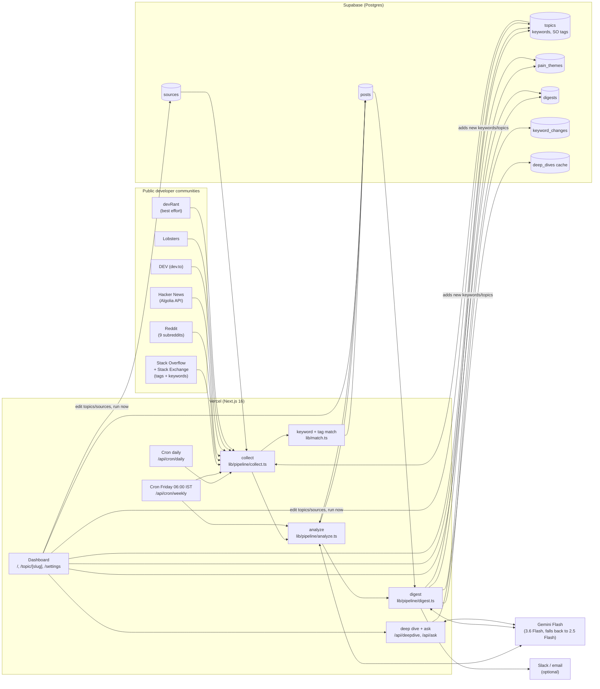

# devcommpulse: Components Map

## What each part does

| Component | File(s) | Job |
|---|---|---|
| Source adapters | `src/lib/sources/*.ts` | Pull the last 8 days (21 on the first run) from each community's public API. |
| Matcher | `src/lib/match.ts` | Keeps a post only if it contains a monitored keyword (whole word, case- and plural-tolerant) or carries a mapped Stack Overflow tag. |
| Collect | `src/lib/pipeline/collect.ts` | Runs the adapters in parallel, buckets each post into a Friday-to-Thursday week, and upserts into `posts` without overwriting AI corrections. |
| Analyze | `src/lib/pipeline/analyze.ts` | Sends posts to Gemini Flash in batches of 25. It gets back relevance, topic, sentiment (−1 to +1), a short pain-point phrase, whether the problem is unresolved, and a severity score. An accepted Stack Exchange answer overrides "unresolved". |
| Digest | `src/lib/pipeline/digest.ts` | Computes week-over-week counts in SQL. Gemini groups the pain-point phrases into themes, with exact counts for this week and last. Gemini then writes the headline, 3–5 bullets and a sprint-planning question, and proposes new keywords or topics. Those are validated, written to `topics`, logged to `keyword_changes`, and used to re-tag older posts. |
| Delivery | `src/lib/notify.ts` | Optionally posts the brief to Slack and/or emails it via Resend. |
| Brief page | `src/app/page.tsx` | Headline, four numbers, topic table (this week vs last, 8-week sparkline, mood, % unresolved), themes, source chart, trend chart, and an Ask box. |
| Topic page | `src/app/topic/[slug]/page.tsx` | Keyword chips (`?kw=` filters everything), trend and keyword charts, themes, top pain points, posts, an on-demand deep dive, and a topic-scoped Ask box. |
| Settings | `src/app/settings`, `src/components/SettingsClient.tsx` | Passcode-protected editing of topics, keywords, Stack Overflow tags and sources, a "Run now" control, and the log of AI-made changes. |
| SQL | `supabase/schema.sql` | Tables, `topic_weekly_stats`, `source_weekly_stats`, `week_totals`, `apply_analysis`, `retag_keyword`, plus seed topics for Sumit's problem space. |

## Schedule

| When (IST) | Route | Does |
|---|---|---|
| Every day 00:00 | `/api/cron/daily` | collect, then analyze |
| Friday 06:00 | `/api/cron/weekly` | collect, analyze, digest, then deliver |

Weeks run Friday 00:00 UTC to Thursday 23:59 UTC, so Friday's brief always describes a complete week.
