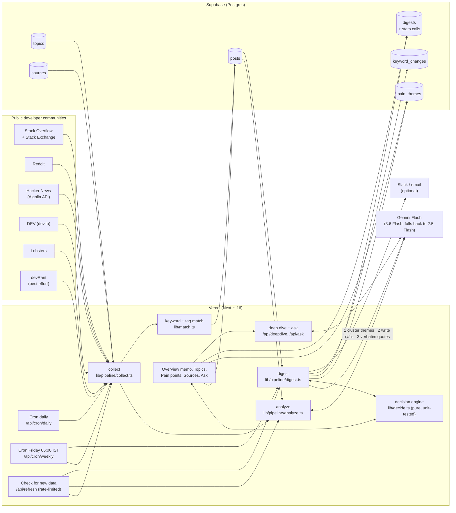
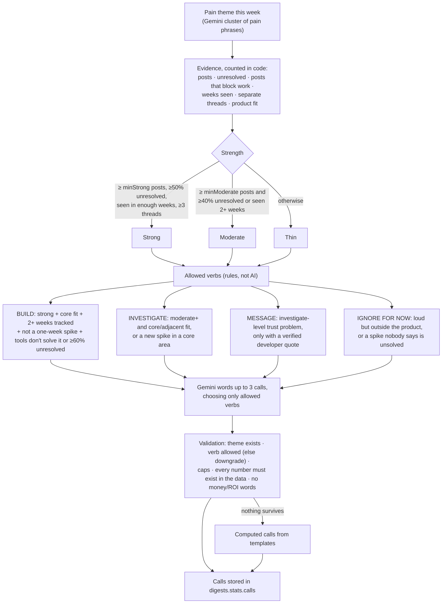

# devcommpulse: Components Map

devcommpulse turns public developer posts into **at most three calls a week** for Sumit, the PM of a code review automation startup: **Build**, **Investigate**, **Message** or **Ignore for now**. Each call comes with the evidence behind it and one next step. Code decides which calls the evidence supports; Gemini only words them, and everything it writes is validated against the data.

## How a call is made

The evidence bar rises with the cost of acting: ignoring costs nothing, a message costs a sales line, investigating costs a few customer conversations, and building costs engineering time. Thresholds scale with the week's pain volume (`minStrong = max(8, 6.5% of pain posts)`, `minModerate = max(5, 4%)`), so more sources don't make everything "strong".

## What each part does

| Component | File(s) | Job |
|---|---|---|
| Source adapters | `src/lib/sources/*.ts` | Pull the last 8 days (21 on the first run) from each community's public API. |
| Matcher | `src/lib/match.ts` | Keeps a post only if it contains a monitored keyword (whole word, case- and plural-tolerant) or carries a mapped Stack Overflow tag. |
| Collect | `src/lib/pipeline/collect.ts` | Runs the adapters in parallel, buckets each post into a Friday-to-Thursday week, and upserts into `posts` without overwriting AI corrections. |
| Analyze | `src/lib/pipeline/analyze.ts` | Sends posts to Gemini Flash in batches of 25: relevance, topic, sentiment, a short pain-point phrase, whether it is unresolved, and severity (3 = blocks work). An accepted Stack Exchange answer overrides "unresolved". |
| Decision engine | `src/lib/decide.ts`, `src/lib/decide.test.ts` | Pure module (no I/O). Evidence per theme, strength, spike detection, allowed verbs, the ranking key, computed calls, call ordering, validation of Gemini's text (number, unit and wording checks; headline/Monday-question checks), quote verification, thread de-duplication, "did the signal hold?", the memo and ticket text. 15 unit tests on the real 2–8 Oct numbers, including regressions found in review (`npm test`). |
| Digest | `src/lib/pipeline/digest.ts` | Friday. Gemini call 1 groups pain phrases into themes and rates each theme's fit with the product. Code counts exact blocking posts and separate threads, builds the evidence table and the allowed verbs. Gemini call 2 writes up to 3 calls, the headline, the Monday question and bullets; everything is validated. Optional call 3 picks a word-for-word quote per call, checked against the post. Stores calls in `digests.stats`, proposes keywords, then delivers. |
| Delivery | `src/lib/notify.ts` | Optionally posts the calls to Slack and/or emails them via Resend, calls first. |
| Overview (decision memo) | `src/app/page.tsx`, `src/components/Memo.tsx` | One screen: headline about call #1, three pulse facts, the yes/no question for Monday sprint planning, up to 3 calls (evidence, next step, quote, and Say · Ask · Measure · Ticket), last week's calls ("did the signal hold?"), what else is on the radar, and an honest coverage note with the method spelled out. "Copy memo" and "Copy as ticket" put it into Slack or Linear. |
| Data layer | `src/lib/data.ts` | `getBrief` (Overview) and `getPainPage` share one `weekEvidence` loader, so the memo and the Pain points table always agree. `getOverview` feeds Topics. |
| Topics & trends | `src/app/topics/page.tsx` | KPIs, what moved this week, biggest movers, topic table, posts-per-week chart and heatmap. |
| Pain points | `src/app/pain-points/page.tsx`, `src/components/ThemesTable.tsx` | Every theme in the same order as the calls, with call, evidence strength, weeks seen and fit; filters for this week's calls, build-ready and "tools don't solve it". |
| Topic page | `src/app/topic/[slug]/page.tsx` | Keyword chips, trend and keyword charts, themes, posts, an on-demand Gemini deep dive and a topic-scoped Ask box. |
| Settings | `src/app/settings`, `src/components/SettingsClient.tsx`, `src/app/api/refresh` | Read-only view of topics, communities and run history, plus a public "Check for new data" button. The server rate-limits it (collect and brief once per 15 min, analysis capped and never concurrent). |
| SQL | `supabase/schema.sql` | Tables, `topic_weekly_stats`, `source_weekly_stats`, `week_totals`, `apply_analysis`, `retag_keyword`, plus seed topics for Sumit's problem space. Unchanged by the calls feature: new outputs live in `digests.stats`. |

## Reliable outputs

| Risk | What stops it |
|---|---|
| Gemini invents a number ("AI PRs over 400 lines", "2x faster", "5k a year") | Every number in its text must appear in the evidence table, topic table or totals (or be a simple difference), and multipliers, money-like magnitudes and time savings are rejected outright; otherwise the sentence is replaced by a template. |
| Gemini recommends building something the data doesn't support | Verbs are decided in code. A disallowed build/message becomes investigate; anything else is dropped. |
| Fake ROI | No dollar, revenue, ROI, pricing or market-size words survive validation. Value is shown as countable unmet demand, and the method says what it does not claim. |
| Made-up or paraphrased quotes | A quote is kept only if it appears word for word (after normalising quotes, dashes and markup) in the post's title or body, and is 8–30 words. Authors are never shown or sent. |
| One viral thread posing as demand | Hacker News comments on the same story count as one thread; strong evidence needs 3+ threads. |
| A one-week spike (e.g. linter complaints 1 → 9) | Flagged as a spike (only when last week's data exists): never Build, never rated "strong", usually "Ignore for now" with a measurable revisit condition. |
| Headline contradicts the calls | Calls are always ordered Build → Investigate → Message → Ignore. Gemini's headline, Monday question and "leans yes/no" are kept only if its first call survived validation unchanged, the text is about call #1, cites only call #1's own numbers, and doesn't lead with an ignored theme; checked when the brief is written and again when the page loads, so the page, Slack and email agree. |
| Late analysis re-grades a call after it was sent | Stored calls are judged with the thresholds they were made with (saved in `digests.stats.thresholds`). |
| Small-number % swings | Theme changes are shown as counts ("12 posts (14 last wk)"), never percentages. |

## Edge cases handled

| Situation | Behaviour |
|---|---|
| Week's brief written before calls existed | Calls are computed from counts, labelled "Computed from counts". |
| Week in progress / brief not run yet | "Calls are made on Friday morning" with a link to last week's calls; "did the signal hold?" waits until the week is clustered. |
| Only 1 week of history | No Build calls and no "spikes" (there is no last week to compare with); a note says so. Thresholds use `min(3, weeks tracked)`. |
| No theme has enough evidence | "No theme has enough evidence for a call this week" plus a link to all themes. |
| Theme renamed between weeks | Matched by same topic and ≥60% word overlap; otherwise "No match this week; it may have been renamed". |
| Reddit blocked, devRant down | Named in the coverage note; the other sources carry on. |
| Analysis still running | Coverage note says numbers may move; the pulse shows "analysis pending" when nothing is analysed. |
| Gemini quote call fails | The brief still saves; calls just have no quote, and Message calls fall back to Investigate. |

## Schedule

| When (IST) | Route | Does |
|---|---|---|
| Every day 00:00 | `/api/cron/daily` | collect, then analyze |
| Friday 06:00 | `/api/cron/weekly` | collect, analyze, digest (calls), then deliver |
| Any time | `/api/refresh` via Settings | collect, analyze, digest, rate-limited |

Weeks run Friday 00:00 UTC to Thursday 23:59 UTC, so Friday's brief always describes a complete week.
